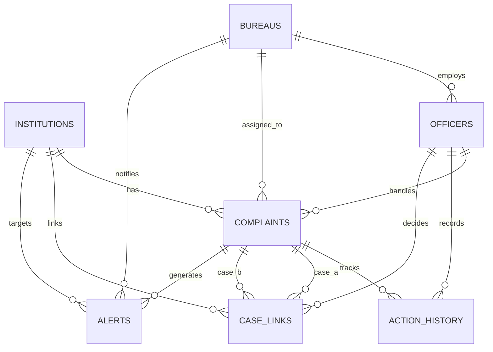

# AICTE Integrated Institution Complaint Monitoring and Coordination Portal
## Phase 0 Blueprint: System Architecture, Data Model & Engine Specifications (Corrected)

> **Document Status**: Final Corrected Phase 0 Blueprint  
> **Environment**: Python 3.11+ / FastAPI / SQLite / React 18 / Tailwind CSS  
> **Target**: Smart India Hackathon Prototype (Solo Developer Track)  
> **Compliance**: GIGW (Guidelines for Indian Government Websites), NIC-Style Architecture, Human-in-the-Loop AI Ethics

---

## 1. Project Overview & Architectural Principles

### 1.1 Problem Statement
The All India Council for Technical Education (AICTE) receives grievances from students, faculty, staff, and the general public across diverse portals (CPGRAMS, AICTE Portal, letters, emails). These grievances are routed to distinct bureaus and cells:
- **RB**: Regulation Bureau (Statutory compliance, unapproved institutions, affiliation norms)
- **PGRC**: Public Grievance Redressal Cell (Individual student/faculty grievances, fee refunds, harassment)
- **AB**: Approval Bureau (Sanctioned intake, course approvals, infrastructure norms)
- **AFB**: Affiliation & Academic Bureau (Curriculum, academic calendars, university affiliations)
- **RO**: Regional Offices (Zonal monitoring and inspections)

Because bureaus operate on siloed registers, multiple bureaus often initiate parallel inquiries on the same institution without mutual visibility. This causes conflicting orders, redundant notices, administrative delay, and institutional evasion.

### 1.2 Core Architectural Principles
1. **Coordination Engine, Not Just a Viewer**: The system detects, calculates, scores, and surfaces overlaps.
2. **Strict Human-in-the-Loop**: The engine **never** auto-merges cases, never reassigns ownership without approval, and never modifies institution identities without authorization. AI suggestions require explicit officer review and approval.
3. **Deterministic & Explainable**: Every match confidence, overlap alert, risk score, and lead bureau suggestion provides a plain-English "Reason List" with exact mathematical attribution.
4. **Resilient Grounding**: Works 100% offline using deterministic rule-based algorithms and template extractors. If an external LLM is configured, its responses are strictly grounded in existing database records with zero hallucination risk.

---

## 2. Directory Structure

```text
AICTE complaint monitor/
├── backend/
│   ├── app/
│   │   ├── __init__.py
│   │   ├── main.py                  # FastAPI app initialization, middleware, routes
│   │   ├── config.py                # Central engine parameters, weights & SLA matrices
│   │   ├── database.py              # SQLite engine, SessionLocal, Base
│   │   ├── models/                  # SQLAlchemy ORM models
│   │   │   ├── __init__.py
│   │   │   ├── institution.py       # Institution & Alias models
│   │   │   ├── bureau.py            # Bureau & Officer models
│   │   │   ├── complaint.py         # Complaint model
│   │   │   ├── action_history.py    # Immutable audit trail
│   │   │   ├── case_link.py         # Overlap links between complaints
│   │   │   └── alert.py             # System notifications & alerts
│   │   ├── schemas/                 # Pydantic v2 schemas for validation
│   │   │   ├── __init__.py
│   │   │   ├── auth.py
│   │   │   ├── institution.py
│   │   │   ├── complaint.py
│   │   │   ├── action_history.py
│   │   │   ├── case_link.py
│   │   │   ├── alert.py
│   │   │   └── dashboard.py
│   │   ├── services/                # Business logic & algorithms
│   │   │   ├── __init__.py
│   │   │   ├── auth_service.py      # Passlib bcrypt hashing & JWT tokens
│   │   │   ├── resolution_engine.py # 3-layer fuzzy institution resolution
│   │   │   ├── overlap_engine.py    # Multi-signal weighted overlap detector
│   │   │   ├── lead_bureau_rules.py # Deterministic lead bureau suggestion logic
│   │   │   ├── risk_scorer.py       # 0-100 institutional risk scoring
│   │   │   ├── sla_service.py       # SLA monitoring & idempotent auto-escalation
│   │   │   └── llm_provider.py      # Abstract LLM adapter (offline fallback + API plug)
│   │   ├── scheduler/               # APScheduler background tasks
│   │   │   ├── __init__.py
│   │   │   └── jobs.py              # SLA monitor & overlap sweep runner
│   │   └── routers/                 # API route controllers
│   │       ├── __init__.py
│   │       ├── auth.py
│   │       ├── institutions.py
│   │       ├── complaints.py
│   │       ├── overlaps.py
│   │       ├── dashboard.py
│   │       ├── alerts.py
│   │       ├── reports.py
│   │       └── admin.py
│   ├── tests/                       # Unit & integration test suite
│   │   ├── __init__.py
│   │   ├── test_resolution.py
│   │   ├── test_overlap.py
│   │   ├── test_lead_bureau.py
│   │   ├── test_sla.py
│   │   ├── test_risk_score.py
│   │   └── test_scenarios.py        # All 6 scripted demo scenarios
│   └── requirements.txt
├── frontend/                        # React 18 + Vite + Tailwind CSS SPA
│   ├── src/
│   │   ├── assets/
│   │   ├── components/
│   │   │   ├── Header.jsx           # Gov bar, tricolor strip, user chip, toggles
│   │   │   ├── Sidebar.jsx          # Left navigation with unread count badges
│   │   │   ├── Footer.jsx           # Synthetic data disclaimer
│   │   │   ├── KpiCard.jsx          # Interactive metric card with drill-down
│   │   │   ├── StatusBadge.jsx      # WCAG AA accessible status pills
│   │   │   ├── RiskGauge.jsx        # Visual risk score gauge & breakdown modal
│   │   │   ├── Timeline.jsx         # Vertical action history visualizer
│   │   │   ├── ReasonBadgeList.jsx  # Explainable "Why this match?" chips
│   │   │   └── Breadcrumbs.jsx
│   │   ├── context/
│   │   │   ├── AuthContext.jsx      # Authentication & RBAC permissions state
│   │   │   ├── LanguageContext.jsx  # English / Hindi localization dictionary
│   │   │   └── AccessibilityContext.jsx # Text scaling (A-, A, A+) & high contrast
│   │   ├── pages/
│   │   │   ├── Login.jsx            # One-click demo credential selector
│   │   │   ├── Dashboard.jsx        # Main dashboard with Recharts visuals
│   │   │   ├── ComplaintsList.jsx   # Filterable & searchable complaint datatable
│   │   │   ├── ComplaintDetail.jsx  # Case overview, action timeline, action modals
│   │   │   ├── InstitutionList.jsx  # Institutions directory with risk ranks
│   │   │   ├── InstitutionDetail.jsx# 360-degree institution profile & history
│   │   │   ├── OverlapReview.jsx    # Side-by-side comparator & decision portal
│   │   │   ├── IntakeComplaint.jsx  # Live extraction & pre-check demo portal
│   │   │   ├── AlertsPage.jsx       # Alert inbox grouped by urgency
│   │   │   ├── ReportsPage.jsx      # Filterable tabular reports with CSV export
│   │   │   └── AdminPage.jsx        # SLA threshold sliders, manual run button
│   │   ├── services/
│   │   │   └── api.js               # Axios instance with auth interceptors
│   │   ├── i18n/
│   │   │   ├── en.json              # English UI copy
│   │   │   └── hi.json              # Hindi UI copy (Devanagari)
│   │   ├── App.jsx
│   │   ├── index.css
│   │   └── main.jsx
│   ├── package.json
│   ├── tailwind.config.js
│   └── vite.config.js
├── data/
│   ├── seed.py                      # Synthetic master seed generator
│   └── aicte_portal.db              # SQLite single-file database
├── docs/
│   ├── PHASE_0_BLUEPRINT.md         # This corrected blueprint
│   ├── ARCHITECTURE.md              # Plain-language algorithmic documentation
│   └── DEMO_SCRIPT.md               # 5-minute judge walkthrough script
├── .env.example
└── README.md
```

---

## 3. Database Schema & Relational Integrity

The schema uses SQLite with strict foreign key constraints, explicit indexing, and cascade definitions.



### 3.1 Table Definitions

#### `institutions`
Represents an AICTE-approved or recorded technical institution.
* `id`: `INTEGER PRIMARY KEY AUTOINCREMENT`
* `permanent_id`: `VARCHAR(32) UNIQUE NOT NULL` (e.g., `1-1099238411`, indexed)
* `name`: `VARCHAR(255) NOT NULL` (official registered name, indexed)
* `normalized_name`: `VARCHAR(255) NOT NULL` (pre-processed lowercase without stop words, indexed)
* `aliases`: `JSON NOT NULL DEFAULT '[]'` (array of known acronyms, past names, short names)
* `address`: `TEXT NOT NULL`
* `city`: `VARCHAR(100) NOT NULL` (indexed)
* `state`: `VARCHAR(100) NOT NULL` (indexed)
* `region`: `VARCHAR(50) NOT NULL` (`North`, `South`, `East`, `West`, `Central`, `North-East`, indexed)
* `pincode`: `VARCHAR(10) NOT NULL` (indexed)
* `institution_type`: `VARCHAR(100) NOT NULL` (`Engineering & Technology`, `Management`, `Pharmacy`, etc.)
* `risk_score`: `FLOAT NOT NULL DEFAULT 0.0` (range: 0.0 to 100.0, indexed)
* `risk_breakdown`: `JSON NOT NULL DEFAULT '{}'` (stores sub-scores for transparency)
* `created_at`: `DATETIME NOT NULL DEFAULT CURRENT_TIMESTAMP`

#### `bureaus`
Organizational units within AICTE handling specific categories of governance.
* `id`: `INTEGER PRIMARY KEY AUTOINCREMENT`
* `code`: `VARCHAR(10) UNIQUE NOT NULL` (`RB`, `PGRC`, `AB`, `AFB`, indexed)
* `name`: `VARCHAR(150) NOT NULL`
* `description`: `TEXT NOT NULL`

#### `officers`
Authorized AICTE personnel with role-based access.
* `id`: `INTEGER PRIMARY KEY AUTOINCREMENT`
* `name`: `VARCHAR(150) NOT NULL`
* `email`: `VARCHAR(150) UNIQUE NOT NULL` (indexed)
* `password_hash`: `VARCHAR(255) NOT NULL` (bcrypt hashed)
* `role`: `VARCHAR(50) NOT NULL` (`RB Officer`, `PGRC Officer`, `AB Officer`, `AFB Officer`, `Regional Officer`, `Senior Management`, `Admin`)
* `bureau_id`: `INTEGER NULL REFERENCES bureaus(id) ON DELETE SET NULL`
* `region`: `VARCHAR(50) NULL` (mandatory for `Regional Officer`, null for HQ officers)
* `is_active`: `BOOLEAN NOT NULL DEFAULT 1`
* `created_at`: `DATETIME NOT NULL DEFAULT CURRENT_TIMESTAMP`

#### `complaints`
Primary grievance record.
* `id`: `INTEGER PRIMARY KEY AUTOINCREMENT`
* `case_id`: `VARCHAR(50) UNIQUE NOT NULL` (e.g., `AICTE/PGRC/2026/00101`, indexed)
* `institution_id`: `INTEGER NULL REFERENCES institutions(id) ON DELETE SET NULL` (indexed)
* `raw_institution_name`: `VARCHAR(255) NOT NULL` (original string received in complaint)
* `source`: `VARCHAR(50) NOT NULL` (`Portal`, `CPGRAMS`, `Email`, `Letter`)
* `category`: `VARCHAR(100) NOT NULL` (indexed)
* `description`: `TEXT NOT NULL`
* `complainant_type`: `VARCHAR(50) NOT NULL` (`Student`, `Faculty`, `Parent`, `Citizen`)
* `date_received`: `DATETIME NOT NULL` (indexed)
* `status`: `VARCHAR(50) NOT NULL DEFAULT 'Pending'` (indexed: `Pending`, `Under Process`, `Disposed`, `Transferred`, `Escalated`)
* `assigned_bureau_id`: `INTEGER NOT NULL REFERENCES bureaus(id) ON DELETE RESTRICT` (indexed)
* `assigned_officer_id`: `INTEGER NULL REFERENCES officers(id) ON DELETE SET NULL` (indexed)
* `last_action`: `VARCHAR(255) NOT NULL DEFAULT 'Grievance Registered'`
* `next_action`: `VARCHAR(255) NOT NULL DEFAULT 'Initial Scrutiny'`
* `last_action_date`: `DATETIME NOT NULL DEFAULT CURRENT_TIMESTAMP`
* `expected_disposal_date`: `DATETIME NOT NULL` (indexed)
* `priority`: `VARCHAR(20) NOT NULL DEFAULT 'Medium'` (`Low`, `Medium`, `High`, `Critical`, indexed)
* `is_overdue`: `BOOLEAN NOT NULL DEFAULT 0` (indexed)
* `is_escalated`: `BOOLEAN NOT NULL DEFAULT 0` (indexed, prevents re-escalation loops)
* `match_confidence`: `FLOAT NULL` (confidence of institution resolution, 0.0 to 1.0)
* `needs_institution_review`: `BOOLEAN NOT NULL DEFAULT 0` (indexed)
* `candidate_institutions`: `JSON NOT NULL DEFAULT '[]'` (stores top 3 candidate matches when in review band)
* `created_at`: `DATETIME NOT NULL DEFAULT CURRENT_TIMESTAMP`

#### `action_history`
Immutable chronological audit log of all case actions, status transitions, transfers, and system triggers.
* `id`: `INTEGER PRIMARY KEY AUTOINCREMENT`
* `complaint_id`: `INTEGER NOT NULL REFERENCES complaints(id) ON DELETE CASCADE` (indexed)
* `timestamp`: `DATETIME NOT NULL DEFAULT CURRENT_TIMESTAMP` (indexed)
* `actor_name`: `VARCHAR(100) NOT NULL` (Officer Name or `SYSTEM`)
* `actor_role`: `VARCHAR(50) NOT NULL`
* `bureau_code`: `VARCHAR(10) NOT NULL`
* `action_type`: `VARCHAR(50) NOT NULL` (`received`, `assigned`, `remark`, `document_added`, `transferred`, `escalated`, `linked`, `unlinked`, `status_change`, `disposed`, `ai_suggestion`, `ai_decision`)
* `remarks`: `TEXT NOT NULL`
* `attachment_name`: `VARCHAR(255) NULL`
* `details`: `JSON NOT NULL DEFAULT '{}'` (contains structured state diff, e.g., `{"old_status": "Pending", "new_status": "Under Process"}`)

#### `case_links`
Tracks detected and approved overlaps between complaint pairs.
* `id`: `INTEGER PRIMARY KEY AUTOINCREMENT`
* `case_a_id`: `INTEGER NOT NULL REFERENCES complaints(id) ON DELETE CASCADE` (indexed)
* `case_b_id`: `INTEGER NOT NULL REFERENCES complaints(id) ON DELETE CASCADE` (indexed)
* `institution_id`: `INTEGER NOT NULL REFERENCES institutions(id) ON DELETE CASCADE` (indexed)
* `similarity_score`: `FLOAT NOT NULL` (0.0 to 1.0)
* `reasons`: `JSON NOT NULL DEFAULT '[]'` (list of human-readable explainable strings)
* `suggested_lead_bureau_id`: `INTEGER NOT NULL REFERENCES bureaus(id) ON DELETE RESTRICT`
* `lead_suggestion_rule`: `VARCHAR(255) NOT NULL` (name and rationale of rule that fired)
* `final_lead_bureau_id`: `INTEGER NULL REFERENCES bureaus(id) ON DELETE SET NULL`
* `status`: `VARCHAR(30) NOT NULL DEFAULT 'suggested'` (`suggested`, `approved`, `rejected`, `needs_discussion`, `related_only`, indexed)
* `decided_by_id`: `INTEGER NULL REFERENCES officers(id) ON DELETE SET NULL`
* `decided_at`: `DATETIME NULL`
* `decision_remarks`: `TEXT NULL`
* `created_at`: `DATETIME NOT NULL DEFAULT CURRENT_TIMESTAMP`
* **Integrity Constraints**:
  - `CHECK (case_a_id < case_b_id)` (enforces canonical ordering to prevent duplicate reciprocal pairs)
  - `UNIQUE (case_a_id, case_b_id)` (prevents multiple links between the same complaint pair)

#### `alerts`
System notifications for overlaps, SLA breaches, and pending reminders.
* `id`: `INTEGER PRIMARY KEY AUTOINCREMENT`
* `type`: `VARCHAR(50) NOT NULL` (`overlap`, `pending_reminder`, `escalation`, `sla_due_soon`, `sla_breached`, indexed)
* `complaint_id`: `INTEGER NULL REFERENCES complaints(id) ON DELETE CASCADE` (indexed)
* `institution_id`: `INTEGER NULL REFERENCES institutions(id) ON DELETE CASCADE` (indexed)
* `message`: `TEXT NOT NULL`
* `severity`: `VARCHAR(20) NOT NULL` (`info`, `warning`, `critical`, indexed)
* `target_bureau_id`: `INTEGER NULL REFERENCES bureaus(id) ON DELETE CASCADE` (indexed)
* `is_read`: `BOOLEAN NOT NULL DEFAULT 0` (indexed)
* `created_at`: `DATETIME NOT NULL DEFAULT CURRENT_TIMESTAMP` (indexed)

---

## 4. Matching & Overlap Engine Specifications

```mermaid
flowchart TD
    subgraph Intake ["1. Institution Resolution Pipeline"]
        Raw["Raw Complaint Input\n(Name, City, State, Pin)"] --> L1{"Layer 1: Exact\nPermanent ID?"}
        L1 -- Yes --> AutoL1["Confidence = 1.0\nDirect Link"]
        L1 -- No --> L2["Layer 2: Text Normalization\n+ RapidFuzz Token Set Ratio"]
        L2 --> L3["Layer 3: Geo Verification\n(City, State, Pincode Match/Penalty)"]
        L3 --> Conf{"Composite Confidence"}
        Conf -- ">= 0.85" --> AutoL2["Auto-Link to Institution"]
        Conf -- "0.60 to 0.84" --> Review["Flag: Needs Institution Review\nSurface Top 3 Candidates"]
        Conf -- "< 0.60" --> Unresolved["Mark as Unresolved\nManual Search Required"]
    end

    subgraph Overlap ["2. Multi-Signal Overlap Engine"]
        Pair["Pair of Open Cases at Same Institution\n(Case A & Case B)"] --> BureauCheck{"Different\nBureaus?"}
        BureauCheck -- No --> NoAlert["No Inter-Bureau Overlap"]
        BureauCheck -- Yes --> ScoreCalc["Calculate 5 Weighted Signals:\n- Same Inst: 0.35\n- Diff Bureau: 0.15\n- Text Cosine Sim: 0.25\n- Category Relation: 0.15\n- Date Proximity: 0.10"]
        ScoreCalc --> OverlapScore{"Composite Score"}
        OverlapScore -- ">= 0.85" --> RedAlert["Strong Overlap Alert\nSuggested Link + Lead Bureau"]
        OverlapScore -- "0.60 to 0.84" --> AmberAlert["Possible Overlap Alert\nReview Required"]
        OverlapScore -- "< 0.60" --> LogOnly["Below Threshold\nNo Alert Generated"]
    end
```



### 4.1 Institution Resolution Engine (3 Layers)

When a complaint arrives with raw institutional text, the engine determines the corresponding canonical institution:

#### Layer 1: Permanent ID Match
If an AICTE Permanent ID (format: `1-[0-9]{9,10}`) is provided in the input, perform an exact lookup on `institutions.permanent_id`.
* Match found $\rightarrow$ Confidence = `1.00`, immediate auto-link.

#### Layer 2: Text Normalization & Fuzzy Token Matching
1. **Normalization Routine**:
   - Convert to lowercase, strip punctuation and excessive whitespace.
   - Expand standard technical education abbreviations using a defined dictionary:
     `{"inst.": "institute", "inst": "institute", "tech.": "technology", "tech": "technology", "engg.": "engineering", "engg": "engineering", "coll.": "college", "coll": "college", "univ.": "university", "univ": "university", "dept.": "department", "mgmt.": "management"}`.
   - Remove generic filler terms: `"the"`, `"of"`, `"for"`, `"and"`.
2. **Fuzzy Scoring**:
   - Compute `RapidFuzz.fuzz.token_set_ratio` against the candidate's `normalized_name` and all entries in `aliases`.
   - Base Text Score $S_{\text{name}} \in [0.0, 1.0]$.

#### Layer 3: Geographic Verification & Disambiguation
Institutions across India frequently share identical or similar names (e.g., "National College of Engineering" in Jaipur vs Raipur). Geographic signals serve as confirmation or contradiction:
* **Pincode Match**: If both complaint and institution have pincodes:
  - Exact 6-digit match: $+0.20$ bonus.
  - First 3 digits match (same postal zone): $+0.10$ bonus.
  - Complete mismatch: $-0.25$ penalty.
* **City Match**:
  - Exact city match: $+0.15$ bonus.
  - Explicit city contradiction (complaint specifies City X, institution is in City Y): $-0.40$ penalty.
* **State Match**:
  - Exact state match: $+0.05$ bonus.
  - Explicit state contradiction: $-0.30$ penalty.

#### Composite Resolution Confidence Formula:
$$C_{\text{res}} = \max\left(0.0, \min\left(1.0, S_{\text{name}} \times 0.65 + S_{\text{geo}}\right)\right)$$
where $S_{\text{geo}} = \text{PincodeBonus} + \text{CityBonus} + \text{StateBonus} - \text{Penalties}$.

#### Resolution Thresholds:
* $C_{\text{res}} \ge 0.85$: **Auto-Link**. Institution ID is linked automatically; logged with confidence.
* $0.60 \le C_{\text{res}} < 0.85$: **Human Review Required**. Set `needs_institution_review = 1`. Store top 3 candidates with confidence scores and city/state for one-click officer confirmation.
* $C_{\text{res}} < 0.60$: **Unresolved**. `institution_id = NULL`. Officer can manually search the master institution registry.

---

### 4.2 Multi-Signal Complaint Overlap Scoring

A shared institution is a prerequisite for case overlap, but two complaints at the same institution are not necessarily overlapping actions. Overlap detection measures the probability that two cases in **different bureaus** involve the same underlying incident, grievance, or administrative deficiency.

#### Mathematical Formula:
$$\text{Score}_{\text{overlap}} = w_1 S_{\text{inst}} + w_2 S_{\text{bureau}} + w_3 S_{\text{text}} + w_4 S_{\text{cat}} + w_5 S_{\text{date}}$$

Where $\sum_{i=1}^5 w_i = 1.00$. The assigned weights are:
* $w_1 = 0.35$ (**Same Institution**):
  - $S_{\text{inst}} = 1.0$ if both cases resolve to the identical `institution_id`.
  - If $S_{\text{inst}} = 0.0$, $\text{Score}_{\text{overlap}} = 0.0$ (hard exit prerequisite).
* $w_2 = 0.15$ (**Different Bureaus**):
  - $S_{\text{bureau}} = 1.0$ if `case_a.assigned_bureau_id != case_b.assigned_bureau_id`.
  - $S_{\text{bureau}} = 0.0$ if both cases are within the same bureau (internal bureau duplicates are routed to internal case lists).
* $w_3 = 0.25$ (**Text Similarity**):
  - $S_{\text{text}} \in [0.0, 1.0]$: Cosine similarity of complaint descriptions computed via TF-IDF vectors (English stopwords removed, sublinear term frequency scaling).
* $w_4 = 0.15$ (**Category Relationship**):
  - $S_{\text{cat}} = 1.0$ if `category_a == category_b`.
  - $S_{\text{cat}} = 0.6$ if categories are mapped as related in the Category Relationship Matrix.
  - $S_{\text{cat}} = 0.0$ if categories are unrelated.
* $w_5 = 0.10$ (**Date Proximity**):
  - Let $\Delta d = |\text{date\_received}_A - \text{date\_received}_B|$ in days.
  - $S_{\text{date}} = \max\left(0.0, 1.0 - \frac{\Delta d}{180}\right)$. If filed within 15 days, $S_{\text{date}} \approx 0.92 - 1.0$.

#### Category Relationship Matrix:
* `Fee Related` $\leftrightarrow$ `Admission Irregularity` ($0.6$), `Harassment/Student Welfare` ($0.6$), `Approval/Affiliation Compliance` ($0.6$ when complaint mentions capitation or unapproved fee charges)
* `Faculty Shortage` $\leftrightarrow$ `Approval/Affiliation Compliance` ($0.6$), `Infrastructure` ($0.6$)
* `Approval/Affiliation Compliance` $\leftrightarrow$ `Fake/Unapproved Courses` ($0.6$), `Faculty Shortage` ($0.6$), `Infrastructure` ($0.6$)
* `Admission Irregularity` $\leftrightarrow$ `Fake/Unapproved Courses` ($0.6$), `Placement Misrepresentation` ($0.6$)
* `Examination/Result` $\leftrightarrow$ `Harassment/Student Welfare` ($0.6$)

#### Overlap Threshold Bands:
* $\text{Score}_{\text{overlap}} \ge 0.85$: **Strong Overlap Alert** (Red notification banner, suggested link created, lead bureau suggested).
* $0.60 \le \text{Score}_{\text{overlap}} < 0.85$: **Possible Overlap - Human Review Required** (Amber notification, surfaces in Overlap Coordination Queue).
* $\text{Score}_{\text{overlap}} < 0.60$: **No Alert**. Pair is retained in audit logs without triggering notification.

---

### 4.3 Deterministic Lead-Bureau Rules

When an overlap is detected, the engine suggests a Lead Bureau to coordinate the cases. The rules are declared as static configuration and executed through named functions:

```text
Rule Hierarchy (evaluated in strict order of precedence):
1. RULE_STATUTORY_REGULATORY:
   If any complaint involves "Approval/Affiliation Compliance", "Fake/Unapproved Courses",
   or an active show-cause/regulatory inspection -> Regulation Bureau (RB) leads.
   Rationale: Statutory and affiliation compliance takes legal precedence over grievance redressal.

2. RULE_INFRASTRUCTURE_APPROVAL:
   If any complaint involves sanctioned intake violation, building/land deficit, or lab deficiency
   without active show-cause -> Approval Bureau (AB) leads.
   Rationale: Intake and infrastructure are governed by Approval Process Handbook norms.

3. RULE_INDIVIDUAL_GRIEVANCE:
   If both complaints involve individual student/faculty welfare, fee refund, harassment, or marksheet withholding
   -> Public Grievance Redressal Cell (PGRC) leads.
   Rationale: PGRC is the specialized mandate cell for student/faculty dispute resolution.

4. RULE_DEFAULT_JOINT_REVIEW:
   If high severity applies across multiple bureaus or conditions conflict
   -> Nominate the bureau with the earliest open case; flag as "Joint Review Recommended".
   Rationale: Prevents deadlock while preserving historical inquiry continuity.
```

> [!IMPORTANT]
> **No Automatic Transfer**: The suggested lead bureau is solely an actionable recommendation. Case ownership does **not** transfer until an officer from an involved bureau clicks "Approve Link" and confirms the lead bureau.

---

## 5. Service Level Agreements (SLA) & Auto-Escalation

### 5.1 SLA Timeline Calculations
* **Clock Start**: Exact timestamp of `date_received`.
* **Standard Category Durations**:
  - `Harassment/Student Welfare`: 15 days
  - `Fake/Unapproved Courses`: 20 days
  - `Examination/Result`: 20 days
  - `Fee Related`: 30 days
  - `Approval/Affiliation Compliance`: 30 days
  - `Admission Irregularity`: 30 days
  - `Placement Misrepresentation`: 40 days
  - `Faculty Shortage`: 45 days
  - `Infrastructure`: 45 days
  - `Other`: 30 days
* **Priority Multipliers**:
  - `Critical`: $0.4\times$ (e.g., Harassment Critical = $15 \times 0.4 = 6$ days)
  - `High`: $0.7\times$ (e.g., Fee Related High = $30 \times 0.7 = 21$ days)
  - `Medium`: $1.0\times$ (standard base duration)
  - `Low`: $1.5\times$ (e.g., Infrastructure Low = $45 \times 1.5 = 68$ days)
* **Disposal Deadline Formula**:
  $$\text{expected\_disposal\_date} = \text{date\_received} + \text{round}(\text{BaseDays} \times \text{Multiplier})$$
  *(Calculated using calendar days for statutory reporting consistency).*

### 5.2 Status Transitions & Overdue Detection
* **Normal**: Time elapsed $< 80\%$ of duration.
* **Due Soon**: Time remaining $\le 20\%$ of duration, and status $\notin \{\text{Disposed}, \text{Transferred}\}$.
* **Overdue**: Current timestamp $> \text{expected\_disposal\_date}$, and status $\notin \{\text{Disposed}, \text{Transferred}\}$. `is_overdue` is set to `1`.
* **Auto-Escalation**:
  - If a case is overdue by more than `SLA_AUTO_ESCALATE_OVERDUE_DAYS` (default: 7 days) and `is_escalated == 0`:
    1. Update status to `Escalated`.
    2. Set `is_escalated = 1`.
    3. Generate a `critical` alert targeted to `Senior Management`.
    4. Append an entry in `action_history` with actor `SYSTEM (SLA Engine)`: *"Case automatically escalated to Senior Management due to exceeding disposal deadline by X days"*.
  - **Loop Prevention**: Because `is_escalated` is checked, subsequent runs of the scheduler recognize the case is already escalated and do not re-trigger alerts or write duplicate audit entries.

---

## 6. Institutional Risk Scoring (0 to 100)

The Institutional Risk Score quantifies systemic non-compliance. It is recalculated whenever a complaint is registered, updated, or disposed, and during the scheduled sweep.

### 6.1 Formula & Normalization
$$\text{RiskScore} = \min\left(100.0, \, C_{\text{vol}} + C_{\text{pen}} + C_{\text{sev}} + C_{\text{rep}} + C_{\text{ovl}}\right)$$

| Component | Weight | Raw Metric | Normalization Formula | Max Pts |
|---|---|---|---|---|
| **Complaint Volume** ($C_{\text{vol}}$) | 30% | Complaints in last 24 months ($N_{24}$) | $\min\left(30.0, \, N_{24} \times 3.0\right)$ | 30 |
| **Pending Ratio** ($C_{\text{pen}}$) | 20% | Open cases ratio ($N_{\text{open}} / N_{\text{total}}$) | $\left(\frac{N_{\text{open}}}{N_{\text{total}}}\right) \times 20.0$ | 20 |
| **Severity Penalty** ($C_{\text{sev}}$) | 20% | Count of Critical ($N_{\text{crit}}$) & High ($N_{\text{high}}$) cases | $\min\left(20.0, \, N_{\text{crit}} \times 5.0 + N_{\text{high}} \times 3.0\right)$ | 20 |
| **Repeat Categories** ($C_{\text{rep}}$) | 15% | Number of categories with $\ge 3$ complaints ($M_{\text{rep}}$) | $\min\left(15.0, \, M_{\text{rep}} \times 5.0\right)$ | 15 |
| **Unresolved Overlaps** ($C_{\text{ovl}}$) | 15% | Count of active unapproved overlaps ($N_{\text{ovl}}$) | $\min\left(15.0, \, N_{\text{ovl}} \times 5.0\right)$ | 15 |

### 6.2 Risk Bands
* **Low Risk**: $0.0 - 39.9$ (Normal operational profile)
* **Medium Risk**: $40.0 - 69.9$ (Heightened surveillance recommended)
* **High Risk**: $70.0 - 100.0$ (Candidate for joint multi-bureau physical inspection)

Every institution profile displays an itemized "Why this score" breakdown showing the exact points contributed by each of the 5 components.

---

## 7. Security, Authentication & Role-Based Access Control (RBAC)

### 7.1 Security Architecture
* **Password Hashing**: `bcrypt` via `passlib[bcrypt]` with work factor 12. Plaintext passwords never stored.
* **Token Standard**: JWT (JSON Web Token) with HS256 signature.
  - Expiration: Configurable via `ACCESS_TOKEN_EXPIRE_MINUTES` (default: 480 minutes / 8 hours for demo).
  - Secret key loaded exclusively from `JWT_SECRET` environment variable (warns and fails startup if default key is used in production).
* **Server-Side Authorization**: Enforced on every API endpoint via FastAPI dependencies (`get_current_active_user`, `require_bureau_membership`, `require_role`).

### 7.2 Role Permissions Matrix

| Role | Scope of Access | Can Act On (Status, Remarks) | Link Approval Authority | Can Trigger Admin Sweeps |
|---|---|---|---|---|
| **RB Officer** | All bureaus (Read); RB (Write) | RB cases only | RB-involved overlaps | No |
| **PGRC Officer** | All bureaus (Read); PGRC (Write) | PGRC cases only | PGRC-involved overlaps | No |
| **AB Officer** | All bureaus (Read); AB (Write) | AB cases only | AB-involved overlaps | No |
| **AFB Officer** | All bureaus (Read); AFB (Write) | AFB cases only | AFB-involved overlaps | No |
| **Regional Officer** | Own Region (Read/Write) | Own region cases | Region-involved overlaps | No |
| **Senior Management** | All Bureaus & Regions (Read-All) | Any case (Escalations/Approvals) | Any overlap link | View status only |
| **Admin** | System configuration | User accounts, system flags | System maintenance | Yes (Full control) |

---

## 8. API Specification & Standards

* **Base URL**: `/api/v1`
* **Response Envelope**: Standard JSON with consistent keys.
* **Pagination**: Query params `page` (default: 1), `limit` (default: 20, max: 100).
* **Standard Error Format**:
  ```json
  {
    "error": {
      "code": "ENTITY_NOT_FOUND",
      "message": "Complaint AICTE/PGRC/2026/00101 does not exist",
      "details": null
    }
  }
  ```

### 8.1 Endpoint Catalog

#### Auth & Identity
* `POST /api/v1/auth/login` (Body: `{email, password}`) $\rightarrow$ `{access_token, token_type, officer}`
* `GET /api/v1/auth/me` $\rightarrow$ Profile, bureau code, permissions

#### Institutions
* `GET /api/v1/institutions` $\rightarrow$ Paginated list, search query, filter by region, state, risk band
* `GET /api/v1/institutions/{id}` $\rightarrow$ Complete institution dossier, risk breakdown, all associated cases
* `GET /api/v1/institutions/{id}/summary` $\rightarrow$ Grounded factual summary generated by LLM provider
* `POST /api/v1/institutions/resolve-preview` (Body: `{raw_name, city, state, pincode}`) $\rightarrow$ Test resolution pipeline

#### Complaints
* `GET /api/v1/complaints` $\rightarrow$ Filterable list (bureau, category, status, region, overdue, has_overlap, search)
* `GET /api/v1/complaints/{id}` $\rightarrow$ Case detail, complete `action_history` timeline, active links
* `POST /api/v1/complaints` $\rightarrow$ Ingest complaint (runs resolution, calculates SLA, triggers overlap check)
* `PATCH /api/v1/complaints/{id}` $\rightarrow$ Update status, add remark, set next action (RBAC enforced)
* `POST /api/v1/complaints/{id}/transfer` (Body: `{target_bureau_id, remarks}`) $\rightarrow$ Bureau transfer with audit log
* `POST /api/v1/complaints/{id}/escalate` (Body: `{remarks}`) $\rightarrow$ Manual escalation to Senior Management

#### Intake Analysis
* `POST /api/v1/intake/extract` (Body: `{complaint_text}`) $\rightarrow$ Extracted fields (institution guess, category, priority, complainant type)
* `POST /api/v1/intake/pre-check` (Body: `{institution_id, category, description}`) $\rightarrow$ Live overlap pre-check before saving

#### Overlap Coordination
* `GET /api/v1/overlaps` $\rightarrow$ List detected overlaps (filter by status, bureau, min_score)
* `GET /api/v1/overlaps/{id}` $\rightarrow$ Side-by-side comparison payload (cases A & B, diff, reasons, suggested lead)
* `POST /api/v1/overlaps/{id}/approve` (Body: `{lead_bureau_id, remarks}`) $\rightarrow$ Approve link, establish lead bureau
* `POST /api/v1/overlaps/{id}/reject` (Body: `{remarks}`) $\rightarrow$ Mark false match, suppress duplicate future alerts
* `POST /api/v1/overlaps/{id}/discuss` (Body: `{comment}`) $\rightarrow$ Post coordination query to other bureau officer

#### Dashboard & Analytics
* `GET /api/v1/dashboard/summary` $\rightarrow$ KPI counts (Total, Pending, Disposed, Overdue, Active Overlaps)
* `GET /api/v1/dashboard/bureau-workload` $\rightarrow$ Workload breakdown by bureau and status
* `GET /api/v1/dashboard/region-wise` $\rightarrow$ Geographic distribution
* `GET /api/v1/dashboard/category-wise` $\rightarrow$ Category distribution
* `GET /api/v1/dashboard/ageing` $\rightarrow$ Ageing buckets (0-15, 16-30, 31-60, 60+ days)
* `GET /api/v1/dashboard/monthly-trend` $\rightarrow$ 12-month intake vs disposal trend
* `GET /api/v1/dashboard/top-risk-institutions` $\rightarrow$ Top 10 institutions by risk score

#### Alerts & Administration
* `GET /api/v1/alerts` $\rightarrow$ Officer's unread alerts
* `PATCH /api/v1/alerts/{id}/read` $\rightarrow$ Mark alert acknowledged
* `GET /api/v1/reports/{report_type}` (Query: `format=csv`) $\rightarrow$ Export CSV dataset
* `POST /api/v1/admin/run-checks` $\rightarrow$ Manually trigger SLA monitor and overlap sweep
* `POST /api/v1/admin/reseed` $\rightarrow$ Reset database to synthetic baseline

---

## 9. Intake Extraction & Grounded LLM Architecture

```text
┌────────────────────────────────────────────────────────────────────────┐
│                        LLMProvider Interface                           │
│  + generate(prompt: str, context: dict) -> str                        │
│  + extract_complaint(text: str) -> ExtractedComplaintSchema           │
│  + summarize_institution(records: dict) -> str                        │
└───────────────────▲────────────────────────────────▲───────────────────┘
                    │                                │
    ┌───────────────┴───────────────┐  ┌─────────────┴─────────────────┐
    │     TemplateLLMProvider       │  │    ConfiguredAPILLMProvider   │
    │  - 100% offline & zero key    │  │  - Active if API key provided │
    │  - Regex & keyword heuristics │  │  - OpenAI / Gemini / Ollama   │
    │  - Factual templated summary  │  │  - System prompt: Ground only │
    └───────────────────────────────┘  └───────────────────────────────┘
```

1. **Zero-Key Offline Guarantee**: The system operates out-of-the-box using `TemplateLLMProvider`. It utilizes regex pattern matching and keyword dictionaries to extract category, priority, and candidate institution without any network calls.
2. **Grounded Institution Summaries**: When generating an institution summary, the input prompt is strictly constrained to the institution's verified case counts, categories, and disposal rates. The system instructions explicitly mandate: *"State only facts contained in the provided record. Never extrapolate or invent allegations."*
3. **AI vs Officer Boundary**:
   - Extraction $\rightarrow$ System suggestion (editable in the UI before submission).
   - Institution Resolution $\rightarrow$ System score (requires one-click confirmation if in 0.60–0.84 band).
   - Overlap Detection $\rightarrow$ Coordination alert (requires officer approval).
   - Lead Bureau $\rightarrow$ Recommended anchor (requires officer confirmation).

---

## 10. The Six Scripted Demo Scenarios (Verified Math & Pass Criteria)

### Scenario 1: Strong Inter-Bureau Complaint Overlap
> **Note on Scenario 1 Data**: The descriptions below represent constructed synthetic demo data designed to evaluate gated multi-signal engine scoring and deterministic lead-bureau routing. They should not be interpreted as empirical proof of open-domain semantic paraphrase handling.

* **Context**: A technical institute in Pune is facing both a student fee dispute in PGRC and a regulatory show-cause inquiry in RB.
* **Input Data**:
  - *Case A (PGRC)*: Case ID `AICTE/PGRC/2026/00101`, Institution: "ABC Inst. of Tech., Pune" (Permanent ID: `1-1099238411`), Category: `Fee Related`, Description: *"Student grievance against college for collecting Rs 25,000 unapproved caution money deposit and extra examination fees without receipt, refusing refund, and withholding hall ticket admit card."*, Date Received: `2026-09-15`.
  - *Case B (RB)*: Case ID `AICTE/RB/2026/00204`, Institution: "ABC Institute of Technology, Pune" (Permanent ID: `1-1099238411`), Category: `Approval/Affiliation Compliance`, Description: *"Show-cause notice to college regarding unauthorized collection of Rs 25,000 caution money deposit, charging extra examination fees without receipt, non-refund, and withholding student hall ticket admit card."*, Date Received: `2026-09-18`.
* **Gating Conditions**:
  - Same Institution: Passed (Both resolved to `1-1099238411`)
  - Different Bureaus: Passed (PGRC vs. RB)
  - Both Cases Open: Passed (Statuses: Under Process)
* **Mathematical Calculation**:
  - Text Similarity: Cosine similarity on concept-normalized phrasing $= 0.916 \rightarrow 0.50 \times 0.916 = 0.458$
  - Category Relationship: Configurable relatedness value between `Fee Related` and `Approval/Affiliation Compliance` ($S_{\text{cat}} = 0.80$) $\rightarrow 0.30 \times 0.80 = 0.240$
  - Date Proximity: $\Delta d = 3$ days $\rightarrow S_{\text{date}} = 1.0 - \frac{3}{180} = 0.983 \rightarrow 0.20 \times 0.983 = 0.197$
  - **Total Overlap Score**: $0.458 + 0.240 + 0.197 = \mathbf{0.895}$ ($\ge 0.88$)
* **Rules Fired**: `RULE_STATUTORY_REGULATORY` (RB leads due to show-cause regulatory compliance scrutiny).
* **Expected Outcome**: **Strong Overlap Alert** (Red badge, score 89%), Suggested Lead Bureau: **RB**, Reason: *"Same Permanent ID (1-1099238411); Active across distinct bureaus (PGRC and RB); High text similarity (91.6%); Related categories (80%); Statutory regulatory show-cause rule RB leads."*

### Scenario 2: False Institution Match Avoidance
* **Context**: Two separate institutions with very similar names located in different states.
* **Input Data**:
  - *Case A*: "National College of Engineering, Jaipur", City: "Jaipur", State: "Rajasthan", Pincode: "302001".
  - *Case B*: "National College of Engineering, Raipur", City: "Raipur", State: "Chhattisgarh", Pincode: "492001".
* **Mathematical Calculation**:
  - Name token ratio: $1.00 \times 0.65 = 0.65$
  - City Contradiction Penalty: $-0.40$
  - State Contradiction Penalty: $-0.30$
  - Pincode Mismatch Penalty: $-0.25$
  - **Composite Resolution Score**: $\max(0.0, 0.65 - 0.95) = \mathbf{0.00}$
* **Expected Outcome**: Each case resolves to its respective distinct institution. No cross-institution overlap is generated ($S_{\text{inst}} = 0.0$).

### Scenario 3: Human-Review Institution Match
* **Context**: A complaint arrives with an abbreviated, ambiguous institution name in Bengaluru.
* **Input Data**:
  - Raw name: `"Apex Tech College, Bengaluru"`, City: `"Bengaluru"`, State: `"Karnataka"`.
  - Database contains:
    1. `"Apex Institute of Technology"`, City: `"Bengaluru"` (Pincode: 560001)
    2. `"Apex College of Engineering & Technology"`, City: `"Bengaluru"` (Pincode: 560034)
    3. `"Apex Polytechnic College"`, City: `"Bengaluru"` (Pincode: 560045)
* **Mathematical Calculation for Top Candidate**:
  - Token ratio ("apex institute of technology" vs "apex technology college") $= 0.82 \times 0.65 = 0.533$
  - City Match Bonus: $+0.15$
  - State Match Bonus: $+0.05$
  - **Composite Confidence**: $0.533 + 0.20 = \mathbf{0.733}$ ($0.60 \le C_{\text{res}} < 0.85$)
* **Expected Outcome**: Case is marked `needs_institution_review = 1`. Top 3 candidates are presented in the UI with scores (73%, 68%, 62%) for one-click officer verification.

### Scenario 4: SLA Auto-Escalation
* **Context**: High-priority grievance overdue by 12 days.
* **Input Data**:
  - Case ID: `AICTE/RB/2026/00045`, Category: `Faculty Shortage`, Priority: `High`, Date Received: 55 days ago.
* **Mathematical Calculation**:
  - Base SLA Duration: 45 days. High Priority Multiplier: $0.7\times \rightarrow \text{Target SLA} = 32$ days.
  - Expected Disposal Date: 23 days ago.
  - Overdue Days: $55 - 32 = 23$ days overdue ($23 > 7$ threshold).
* **Expected Outcome**:
  - Clicking "Run Checks Now" evaluates the case.
  - Status updates from `Under Process` to `Escalated`.
  - `is_escalated` set to `1`.
  - Critical Alert created for Senior Management.
  - `action_history` logs the escalation audit event.

### Scenario 5: Live Complaint Intake Demo
* **Context**: Real-time intake demonstration during presentation.
* **Input Data**:
  - Paste messy complaint text: *"Sir my college ABC Tech Pune is not returning caution money and charging extra exam fee without receipt"*
* **Expected Outcome**:
  1. Instant extraction: Identifies Category as `Fee Related`, Priority as `Medium`.
  2. Resolution: Resolves to "ABC Institute of Technology, Pune" (`1-1099238411`).
  3. Pre-check: Detects live active overlap with `AICTE/RB/2026/00204` **before** the officer confirms submission, showing the alert live on screen.

### Scenario 6: Institutional Risk Leaderboard
* **Context**: High-risk institution with multi-bureau repeat offenses.
* **Input Data**:
  - "Sunrise Institute of Technology & Management" (Permanent ID: `1-1099882233`)
  - Complaints in last 24m: 9 complaints
  - Open complaints: 7 of 9 unclosed
  - Severity: 2 Critical, 3 High priority complaints
  - Repeat categories: `Fee Related` (4 complaints), `Faculty Shortage` (3 complaints)
  - Active overlaps: 2 unresolved inter-bureau overlap alerts
* **Mathematical Calculation**:
  1. $C_{\text{vol}} = 9 \times 3.0 = 27.0$ pts (max 30)
  2. $C_{\text{pen}} = (7 / 9) \times 20.0 = 15.56$ pts (max 20)
  3. $C_{\text{sev}} = (2 \times 5.0) + (3 \times 3.0) = 19.0$ pts (max 20)
  4. $C_{\text{rep}} = 2 \text{ categories} \times 5.0 = 10.0$ pts (max 15)
  5. $C_{\text{ovl}} = 2 \text{ overlaps} \times 5.0 = 10.0$ pts (max 15)
  - **Total Risk Score**: $27.0 + 15.56 + 19.0 + 10.0 + 10.0 = \mathbf{81.56} \approx \mathbf{82}$ (**High Risk Band**)
* **Expected Outcome**: Appears at #1 on the Institutional Risk Leaderboard. Clicking the score displays the itemized "Why this score" breakdown showing all 5 components.

---

## 11. Preserved Six-Phase Project Execution Plan

The project development follows the original six-phase plan strictly. Each phase must be reviewed, executed upon approval, and verified before proceeding to the next.

```text
Phase 1: Project Skeleton, Database Models, Seed Script & Data Layer Tests
Phase 2: Matching & Overlap Engine with Config, Reasons, Lead-Bureau Rules & Unit Tests
Phase 3: FastAPI Backend with Auth, Endpoints, SLA Scheduler, Alerts & Risk Scorer
Phase 4: Frontend Shell: Layout, Accessibility, Routing & Dashboard with Recharts
Phase 5: Complaints Management, Case Details Timeline & Institution 360 Profiles
Phase 6: Overlap Review, Live Intake Analysis Demo, Reports, Admin & End-to-End Verification
```

---

## 12. Phase 0 Completion Verification Checklist

- [x] Multi-signal overlap formula verified mathematically to produce values strictly in $[0.0, 1.0]$.
- [x] Category relationship matrix formalized and integrated with date proximity and text similarity.
- [x] Institution resolution separated from complaint overlap scoring.
- [x] Geographic disambiguation and contradiction penalties specified to prevent cross-city false matches.
- [x] Foreign keys, cascade behaviors, uniqueness constraints, and index strategies fully documented.
- [x] `action_history.complaint_id` standardized across all models and schemas.
- [x] Self-links and duplicate reciprocal links strictly prohibited via database constraints.
- [x] Server-side RBAC, bcrypt password hashing, and JWT expiration fully defined.
- [x] Lead bureau rules decoupled into named functional components with clear precedence hierarchy.
- [x] SLA calculations, weekend/calendar day definitions, and escalation loop prevention formalized.
- [x] Institutional risk score defined with closed-form mathematical equations and verified against sample data.
- [x] Grounded, offline-first LLM provider specified with zero-hallucination guardrails.
- [x] All 6 scripted demo scenarios mathematically validated with explicit pass/fail conditions.
- [x] Original six-phase execution structure strictly preserved.
- [x] Phase 1 has **not** been started.
